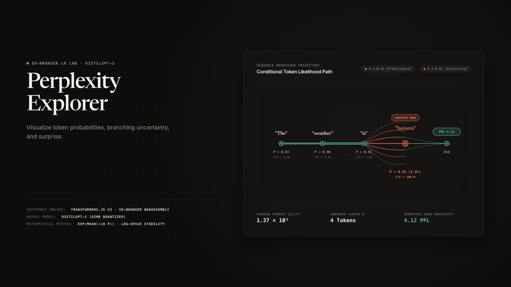

# Perplexity Explorer ⚡

An interactive, museum-grade in-browser laboratory for language model perplexity and next-token prediction.

Run real neural network causal inference (DistilGPT-2 via Transformers.js) directly inside your browser—zero API keys, zero servers, zero build steps.



[](https://perplexity-xplorer.vercel.app)


---

## 🌐 Live Application

- **Production URL**: [https://perplexity-xplorer.vercel.app](https://perplexity-xplorer.vercel.app)
- **GitHub Repository**: [https://github.com/ayujha-dev/Perplexity-Xplorer](https://github.com/ayujha-dev/Perplexity-Xplorer)

---

## Key Highlights

- **⚡ Genuine In-Browser Neural Inference**: Lazy-loads `Xenova/distilgpt2` (`dtype: "q8"`) via Transformers.js v3 on calculation click. Real model outputs are never fabricated.
- **📦 Zero-Delay Preloaded State**: Mounts immediately with a verified cached DistilGPT-2 analysis for *"The capital of France is Paris"* and top 8 next-token predictions, eliminating empty loading states before downloading the 82MB model.
- **🏛️ Beside-Inspired Asymmetric Bento Architecture**:
  - **Section 01 (Command Card)**: Sleek full-width command deck with compact input dock and inline model status indicator pill (`idle / loading / ready`).
  - **Sections 02 & 03 (Asymmetric Bento Row)**: Desktop 8:4 column split pairing token probabilities with next-token distribution.
  - **Prominent Perplexity KPI & Intuition Scale**: Top-level score badge paired with a horizontal intuition meter (`1-10 Predictable`, `10-50 Natural`, `50-200 Odd`, `200+ Surprising`) with a live gliding needle.
  - **Single-Row 3-Column Equation Strip**: Compact mathematical breakdown (`01 · Inverse Product` $\to$ `02 · Sequence Length N` $\to$ `03 · Geometric Mean`).
- **🔗 Synced Token Surprise Strip & Tactile Canvas**:
  - Interactive sequence chips tinted by certainty (muted teal `#0D9488` / `#58B89E`) vs. surprise (warm terracotta `#C2410C` / `#E87555`).
  - Bidirectional cross-highlighting across token chips, branching diagram nodes/rays, and tabular probability rows.
  - Tactile dot-grid diagram canvas with interactive hover tooltips detailing $P$, $1/P$, and $-\ln(P)$ in nats.
- **🧪 "Try It by Hand" 2-Column Interactive Sandbox**:
  - Pre-initialized with the *"One surprising word"* preset (`0.9, 0.9, 0.9, 0.01`).
  - Left column: Dynamic token rows with dual probability controls (number input + smooth range slider).
  - Right column: Sticky live result cockpit with simulated perplexity, horizontal equation strip, and a segmented **Surprise Share ($-\ln P$)** bar proving visually how a single low-probability token dominates total sequence surprise.
- **🎨 High-Craft Beside Aesthetic in Light & Dark Modes**:
  - Warm alabaster paper (`#F7F6F2`) in light mode; deep matte obsidian charcoal (`#0D0D0C`) in dark mode.
  - 1px hairline structural borders, Newsreader serif editorial headings, monospace tabular numbers, and zero gratuitous neon AI slop.

---

## Quick Start

Open `index.html` directly in any modern web browser or serve it with any local static server:

```bash
# Python
python3 -m http.server 3000

# Or npx serve
npx serve .
```

---

## Math Behind Perplexity

Perplexity ($PPL$) is the geometric mean of the inverse probabilities of a sequence of tokens:

$$\text{PPL}(W) = \exp\left( \frac{1}{N} \sum_{i=1}^N -\ln P(w_i \mid w_1, \dots, w_{i-1}) \right) = \left( \prod_{i=1}^N \frac{1}{P(w_i \mid w_{<i})} \right)^{1/N}$$

Intuitively, a perplexity of **$k$** means that on average at each word, the language model was as uncertain as choosing uniformly between **$k$** equally likely words. Lower perplexity indicates the model was less surprised by the text.

---

## Architecture & Documents

- [PRODUCT.md](file:///Users/ayu/Desktop/ppXplorer/PRODUCT.md) — Product truth, audience, and Experience + Operate specification.
- [DESIGN.md](file:///Users/ayu/Desktop/ppXplorer/DESIGN.md) — Design system tokens, color palette, typography ramp, and component rules.
- [index.html](file:///Users/ayu/Desktop/ppXplorer/index.html) — Single self-contained source file.

---

## License

MIT
